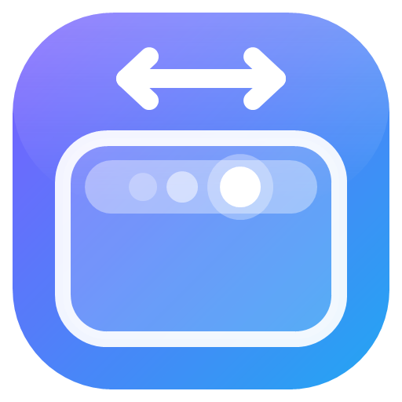

<p align="center">
  
</p>

<h1 align="center">PadGestures</h1>

<p align="center">
  Custom edge gestures for Windows Precision Touchpads: seek videos, change volume and brightness by sliding along the edges of the touchpad.<br>
  <b>English</b> · <a href="README.ru.md">Русский</a>
</p>

---

PadGestures was made for the **ASUS Zenbook Duo** detachable keyboard. The keyboard's touchpad has built-in ASUS edge gestures, but you can't change them: seeking is always 5 seconds, and the zones and speed are fixed. PadGestures replaces them with gestures you can configure. It works with any **Windows Precision Touchpad**.

## Features

- **Four edge zones** (top, bottom, left, right). Each one can be set to **Seek**, **Volume**, **Brightness**, **Previous/next track**, **Scroll** or **Off**.
- **Seek as far as you need in one step**: 15 s, 30 s, up to 5 minutes. In browsers (YouTube, Google Drive and most video sites) PadGestures moves the player's own progress slider through Windows UI Automation. Long videos seek right away, without dozens of key presses. If no slider is found, it falls back to the arrow keys.
- **Speed and acceleration.** You choose how far to slide per step, and a fast swipe makes bigger jumps.
- **Adjustable zone width** and **reverse direction**.
- **Keeps the cursor still** while you slide along an edge.
- **Live preview** shows every finger on the touchpad and highlights the active zone.
- **Material 3 Expressive style UI** that follows the Windows light/dark theme and accent color.
- **Russian and English** (automatic, or chosen manually).
- Runs in the **tray**, with an optional **start with Windows**. If you move the exe, autostart updates its path the next time the program starts.
- A single small `.exe`. Nothing to install, no network access, no telemetry.

## Requirements

- Windows 10 or 11 (64-bit)
- A Precision Touchpad (most modern laptops and the ASUS Zenbook Duo keyboard)
- .NET Framework 4.8, which is already part of Windows 10/11

## Installation

1. Download `PadGestures.exe` from [Releases](../../releases) or build it yourself (see below).
2. Put it somewhere permanent, for example `%LOCALAPPDATA%\Programs\PadGestures\`.
3. Run it. The settings window opens, and the program keeps running in the tray when you close the window.
4. To start it automatically, turn on **Start with Windows** in **General**.

Settings are stored in `%APPDATA%\PadGestures\settings.ini`.

> Windows SmartScreen or an antivirus may warn about an unsigned `.exe` downloaded from the internet. That's normal for small open-source tools. You can always build it from source yourself.

## Usage

Start touching **inside a colored zone** at the edge of the touchpad and slide **along** that edge:

| Zone | Swipe | Default |
|---|---|---|
| Top edge | left / right | Seek ±15 s |
| Left edge | up / down | Volume |
| Right edge | up / down | Brightness |
| Bottom edge | left / right | Off |

If you start at an edge but move toward the center, it counts as a normal cursor movement. Gestures with two or more fingers are left to Windows.

In the PadGestures window itself, seeking and scrolling are only shown, not sent, so they don't change your settings by accident. Test them on a video.

## ASUS Zenbook Duo: turning off the built-in ASUS edge gestures

The ASUS touchpad driver (`AsusPTPFilter.sys`, shown as *ASUS Precision Touchpad (Bluetooth)*) has its own edge "sliders". They run in parallel with PadGestures and grab the corners of the touchpad. Turning them off in the registry doesn't last, because the driver switches them back on. The reliable way is to switch the touchpad to the **standard Windows driver**:

1. Open **Device Manager** and expand **Human Interface Devices**.
2. Right-click **ASUS Precision Touchpad (Bluetooth)**, the one whose hardware ID contains `UP:000D_U:0005`. Choose **Update driver** → **Browse my computer** → **Let me pick from a list**.
3. Select **HID-compliant touch pad** (Microsoft) and click **Next**.

The touchpad keeps working as a normal Windows Precision Touchpad: cursor, tap to click, two-, three- and four-finger gestures, and the settings in *Settings → Bluetooth & devices → Touchpad*. Only the ASUS-specific extras go away.

**To undo it:** Device Manager → the touchpad → **Properties → Driver → Roll Back Driver**, or pick the ASUS driver again from the same list. The ASUS driver package stays on the system. A Windows or ASUS driver update may install the ASUS driver again.

Optionally, you can also stop the ASUS gesture service (as administrator):

```powershell
Stop-Service AsusPTPService; Set-Service AsusPTPService -StartupType Disabled
```

To restore it: `Set-Service AsusPTPService -StartupType Automatic; Start-Service AsusPTPService`.

## How it works

- Touchpad data is read through the **Raw Input API** (HID digitizer usage page `0x0D`, touch pad `0x05`), parsed with `hid.dll`. PadGestures only **reads** touches and never blocks them.
- Seeking uses **UI Automation**: the browser exposes the video player's progress slider, and PadGestures sets its value directly. It keeps track of the target position itself, sends at most one update every 200 ms and checks the result afterwards, because some players (such as Google Drive) ignore commands while they are still seeking.
- **Volume** is set directly through Windows Core Audio (`IAudioEndpointVolume`), so it can change in 1 % steps (the volume keys always change it by 2 %). It follows your finger smoothly. **Tracks** use the standard media keys.
- **Brightness** uses WMI (`WmiMonitorBrightnessMethods`), so it only changes displays that support it, usually the built-in main display. To change it smoothly, the value chases your finger by at most 3 % every 20 ms.

### Known issue: brightness sometimes jumps back

On some laptops (seen on the ASUS Zenbook Duo with an OLED display) the brightness can briefly jump back to an older value during long, very fast swipes back and forth. The jump comes from the vendor software and display driver, not from PadGestures: it also happens when brightness is changed by a plain script, and to some extent with the Fn keys. PadGestures checks the brightness after a swipe and sets the right value again if it was reverted. With normal swipes it's barely noticeable.

## Building from source

You don't need Visual Studio. The C# compiler that comes with Windows is enough:

```bat
build.cmd
```

The result is `dist\PadGestures.exe`. The icon is drawn by `tools\make-icon.ps1`.

## Disclaimer

- PadGestures is an **unofficial** project. It is **not affiliated with, endorsed or supported by ASUS or Microsoft**. *ASUS*, *Zenbook* and *Windows* are trademarks of their respective owners.
- The software is provided **"as is", without warranty of any kind** (see [LICENSE](LICENSE)). **Use it at your own risk.**
- Switching device drivers or disabling vendor services changes your system configuration. Do it only if you understand the steps above and know how to undo them. The authors are not responsible for any damage, data loss or warranty issues.
- PadGestures simulates key presses and changes system volume and brightness on your behalf. It does not collect, store or send any personal data. Everything stays on your computer.

## License

[MIT](LICENSE)
