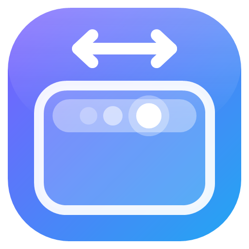

<p align="center">
  
</p>

<h1 align="center">PadGestures</h1>

<p align="center">
  Свои жесты по краям тачпада в Windows: перемотка видео, громкость и яркость свайпом вдоль края.<br>
  <a href="README.md">English</a> · <b>Русский</b>
</p>

---

PadGestures создан для съёмной клавиатуры **ASUS Zenbook Duo**. У её тачпада есть встроенные жесты ASUS по краям, но настроить их нельзя: перемотка всегда на 5 секунд, а зоны и скорость не меняются. PadGestures заменяет их своими жестами, которые настраиваются как угодно. Программа работает с любым **точным тачпадом Windows** (Precision Touchpad).

## Возможности

- **Четыре зоны у краёв** — верх, низ, лево, право. Для каждой можно выбрать: **перемотка**, **громкость**, **яркость**, **предыдущий/следующий трек**, **прокрутка** или **выкл**.
- **Перемотка на любой шаг**: 15 сек, 30 сек, до 5 минут. В браузерах (YouTube, Google Диск и большинство сайтов с видео) программа двигает ползунок самого плеера через UI Automation Windows. Длинные видео перематываются сразу, без десятков нажатий клавиш. Если ползунок не найден, перемотка идёт стрелками.
- **Скорость и ускорение.** Вы задаёте, сколько провести пальцем на один шаг, а быстрый свайп перематывает дальше.
- **Ширина зоны** и **обратное направление** настраиваются.
- **Курсор стоит на месте**, пока вы ведёте пальцем по краю.
- **Живой просмотр** показывает все пальцы на тачпаде и подсвечивает активную зону.
- **Интерфейс в стиле Material 3 Expressive.** Он следует светлой или тёмной теме Windows и её акцентному цвету.
- **Русский и английский язык**: автоматически или вручную.
- Работает **в трее**, можно включить **автозапуск с Windows**. Если перенести exe в другое место, автозапуск сам обновит путь при следующем запуске программы.
- Один небольшой `.exe`. Без установки, без сети, без телеметрии.

## Требования

- Windows 10 или 11 (64-бит)
- Точный тачпад (Precision Touchpad): он есть почти у всех современных ноутбуков и у клавиатуры ASUS Zenbook Duo
- .NET Framework 4.8 — он уже входит в Windows 10/11

## Установка

1. Скачайте `PadGestures.exe` из [Releases](../../releases) или соберите сами (см. ниже).
2. Положите его в постоянное место, например `%LOCALAPPDATA%\Programs\PadGestures\`.
3. Запустите. Откроется окно настроек. Если его закрыть, программа продолжит работать в трее.
4. Для автозапуска включите **«Запускать вместе с Windows»** в разделе **«Общие»**.

Настройки хранятся в `%APPDATA%\PadGestures\settings.ini`.

> Windows SmartScreen или антивирус могут предупредить о неподписанном `.exe`, скачанном из интернета. Для небольших open-source программ это нормально. Вы всегда можете собрать программу сами из исходников.

## Как пользоваться

Начните касание **внутри цветной зоны** у края тачпада и ведите палец **вдоль** края:

| Зона | Свайп | По умолчанию |
|---|---|---|
| Верхний край | влево / вправо | Перемотка ±15 сек |
| Левый край | вверх / вниз | Громкость |
| Правый край | вверх / вниз | Яркость |
| Нижний край | влево / вправо | Выкл |

Если начать касание у края, а повести палец внутрь тачпада, это считается обычным движением курсора. Жесты двумя и более пальцами программа не трогает: их обрабатывает Windows.

В окне самой программы перемотка и прокрутка только показываются, но не отправляются, чтобы случайно не поменять настройки. Проверяйте на видео.

## ASUS Zenbook Duo: как отключить встроенные жесты ASUS по краям

У драйвера тачпада ASUS (`AsusPTPFilter.sys`, в системе он называется *ASUS Precision Touchpad (Bluetooth)*) есть свои «слайдеры» по краям. Они работают параллельно с PadGestures и забирают себе углы тачпада. Выключить их через реестр не получается надолго: драйвер включает их обратно. Надёжный способ — поставить тачпаду **стандартный драйвер Windows**:

1. Откройте **Диспетчер устройств** и разверните раздел **Устройства HID (Human Interface Devices)**.
2. Нажмите правой кнопкой на **ASUS Precision Touchpad (Bluetooth)** — на том, у которого в ИД оборудования есть `UP:000D_U:0005`. Выберите **Обновить драйвер** → **Найти драйверы на этом компьютере** → **Выбрать драйвер из списка**.
3. Выберите **HID-совместимая сенсорная панель** (Microsoft) и нажмите **Далее**.

Тачпад продолжит работать как обычный точный тачпад Windows: курсор, касание как клик, жесты двумя, тремя и четырьмя пальцами, настройки в *Параметры → Bluetooth и устройства → Сенсорная панель*. Пропадут только дополнительные функции ASUS.

**Как вернуть:** Диспетчер устройств → тачпад → **Свойства → Драйвер → Откатить**. Или снова выберите драйвер ASUS из того же списка. Сам драйвер ASUS остаётся в системе. Обновление Windows или драйверов ASUS может поставить его обратно.

Дополнительно можно остановить службу жестов ASUS (PowerShell от имени администратора):

```powershell
Stop-Service AsusPTPService; Set-Service AsusPTPService -StartupType Disabled
```

Вернуть её: `Set-Service AsusPTPService -StartupType Automatic; Start-Service AsusPTPService`.

## Как это устроено

- Касания читаются через **Raw Input API** (HID-страница digitizer `0x0D`, touch pad `0x05`) и разбираются через `hid.dll`. Программа касания только **читает** и никак их не блокирует.
- Перемотка идёт через **UI Automation**: браузер отдаёт ползунок плеера, и программа сразу ставит нужное значение. Целевое время программа считает сама, отправляет обновление не чаще раза в 200 мс и потом проверяет, дошло ли видео. Это нужно потому, что некоторые плееры, например Google Диск, пропускают команды, пока ещё перематывают.
- **Громкость** выставляется напрямую через Windows Core Audio (`IAudioEndpointVolume`), поэтому шаг может быть 1 % (клавиши громкости всегда меняют её на 2 %). Она плавно идёт за пальцем. **Треки** переключаются стандартными мультимедийными клавишами.
- **Яркость** меняется через WMI (`WmiMonitorBrightnessMethods`), поэтому только у экранов, которые это поддерживают, обычно у основного встроенного. Чтобы она менялась плавно, значение догоняет палец не больше чем на 3 % каждые 20 мс.

### Известная проблема: яркость иногда «отпрыгивает» назад

На некоторых ноутбуках (замечено на ASUS Zenbook Duo с OLED-экраном) при долгих и очень быстрых свайпах туда-обратно яркость может на мгновение вернуться к старому значению. Это делают программы производителя и драйвер экрана, а не PadGestures: то же самое происходит, когда яркость меняет простой скрипт, и отчасти с клавишами Fn. После свайпа PadGestures проверяет яркость и, если её откатили, ставит нужное значение снова. При обычных свайпах это почти незаметно.

## Сборка из исходников

Visual Studio не нужен, хватит компилятора C#, который входит в Windows:

```bat
build.cmd
```

Готовый файл появится в `dist\PadGestures.exe`. Иконку рисует скрипт `tools\make-icon.ps1`.

## Отказ от ответственности

- PadGestures — **неофициальный** проект. Он **не связан с ASUS и Microsoft, не одобрен и не поддерживается ими**. *ASUS*, *Zenbook* и *Windows* — товарные знаки их владельцев.
- Программа предоставляется **«как есть», без каких-либо гарантий** (см. [LICENSE](LICENSE)). **Вы используете её на свой риск.**
- Замена драйвера устройства и отключение служб производителя меняют конфигурацию системы. Делайте это, только если понимаете шаги выше и знаете, как всё вернуть. Авторы не отвечают за возможный ущерб, потерю данных или проблемы с гарантией.
- Программа имитирует нажатия клавиш и меняет громкость и яркость системы от вашего имени. Она не собирает, не хранит и не отправляет никаких личных данных. Всё остаётся на вашем компьютере.

## Лицензия

[MIT](LICENSE)
